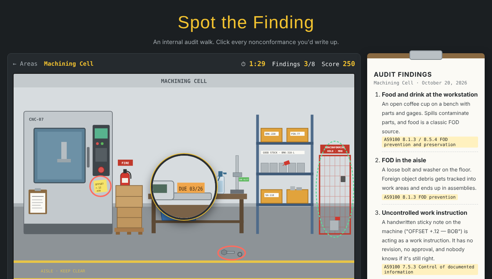

# Spot the Finding

**[▶ Play it in your browser](https://slee9817.github.io/spot-the-finding/)**

An internal audit walk, as a hidden-object game. Each area of a fictional plant has
nonconformances hidden in plain sight: expired calibration, uncontrolled documents, FOD,
mixed or unidentified parts, out-of-spec process readings, and safety issues. Click
everything you'd write up before the clock runs out.

The catch: some things *look* wrong but are compliant, like a rejected part sitting in the
MRB cage, or boxes with HOLD tags in the receiving hold area. Write those up and you lose
points, just like a bad finding wastes everyone's time in a real audit.

- **5 areas, 40 findings:** Machining Cell, Quality Lab, Receiving & Shipping,
  Paint & Powder Coat, and Assembly
- **A magnifying glass** (press Z) for reading stickers, labels, and logs
- **An audit report** at the end: every finding you missed, why it matters, and the
  AS9100 or OSHA clause it violates, plus every false finding and why it was compliant

## How it works

| File | What it does |
|---|---|
| `scenes.js` | Each area as data: an SVG illustration, the findings (with explanations and clause references), and the compliant decoys |
| `game.js` | The engine: click detection, the timer and scoring, the magnifier, the audit report, and saved high scores |
| `index.html`, `style.css` | The page |

The scenes are drawn entirely in SVG code, with no image files. Every clickable item is a
group tagged with an id (`<g data-id="f-cal">`), and a click walks up from the shape you hit
to its group with `closest("[data-id]")`. The magnifier is a second copy of the scene drawn
2.5 times larger inside a circle, shifted so the point under the mouse sits in the center.

Adding an area means adding an entry to `scenes.js`, with no engine changes. Plain HTML,
CSS, and JavaScript: no frameworks, no build step, no server.

## Running it locally

Open `index.html` in any browser.
